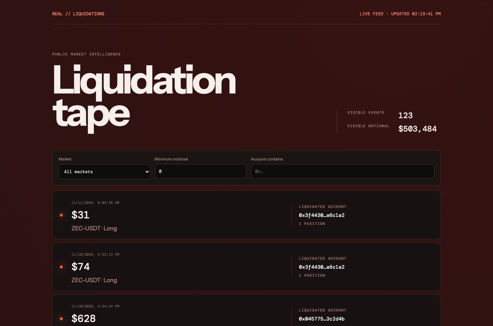

<div align="center">

# REAL Liquidations Explorer

**A clear view of liquidation activity on REAL.**

Search recent events. Follow an account. Inspect the positions behind the numbers.

[](https://github.com/Hug0x0/real-liquidations-explorer/actions/workflows/ci.yml)
[](LICENSE)


[Quick start](#quick-start) · [How it works](#how-it-works) · [Documentation](#documentation) · [Contributing](CONTRIBUTING.md)

</div>

---



REAL Liquidations Explorer is a community-built, read-only interface for public liquidation data. It turns indexer events into a searchable tape with market names, account links, and event-level notional values. No wallet connection or signing is required.

## Features

| Feature | What you can do |
| --- | --- |
| Recent liquidation tape | Browse loaded events, newest first, with timestamps and position counts. |
| Market filter | Show events containing a selected market. |
| Minimum notional | Keep events whose total notional meets a dollar threshold. |
| Account search | Match all or part of an account identifier, ignoring case. |
| Account links | Open a URL with an account filter already applied. |
| Visible totals | See the event count and combined notional for the current filters. |
| Demo fallback | Explore sample events when API loading fails. |
| Responsive interface | Use the tape on desktop or mobile, with keyboard focus indicators and a skip link. |

## Quick start

Use **Node.js 24.22.1** (the version used in CI) and npm.

```bash
git clone https://github.com/Hug0x0/real-liquidations-explorer.git
cd real-liquidations-explorer
npm ci
npm run dev
```

Open the local URL printed by Vite.

### Configuration

The default API base URL is `https://indexer.api.real.xyz`. To override it, copy the example environment file:

```bash
cp .env.example .env
```

Set `VITE_REAL_API_URL` to the desired base URL, without a trailing slash, then restart the development server. The API must expose compatible endpoints and allow requests from the application's origin.

`VITE_` values are included in the browser bundle. Use this setting for a public API URL, never for secrets.

## How it works

Markets are discovered from the indexer, including BTC-USDT, ETH-USDT, SOL-USDT, HYPE-USDT, XRP-USDT, and XAUT-USDT. New markets require no hard-coded allowlist; the list is refreshed with the feed every 30 seconds. Demo fixtures also include these six markets, with synthetic prices and events.

1. On page load, then every 30 seconds, the browser requests market metadata and liquidation events from the REAL indexer.
2. The app resolves market symbols, computes each event's total notional, and sorts the events by timestamp.
3. Filters run locally against the loaded events. The summary updates with the visible results.
4. Clicking an account opens `?account=<account-id>` and pre-fills the account filter.

**Notional is position value, not a trader's realized loss.** The app uses a supplied nonzero notional when available; otherwise it estimates position value from size and a price. See [data semantics](docs/DATA.md) for the exact rules.

### Feed behavior and current limits

- **LIVE FEED** means the liquidation request succeeded. The feed is polled every 30 seconds (no WebSocket) and the navigation bar shows the time of the last successful refresh. If a later refresh fails, the last live events stay on screen and the label adds **REFRESH FAILED**.
- If only the market request fails, live events are still shown; market symbols fall back to identifiers and notional uses event prices.
- **DEMO FEED** is shown initially and remains active if the first liquidation request fails. In that case, both datasets are replaced with sample data.
- The app requests one page of up to 200 markets and 250 liquidation events. API limits may differ; the app does not fetch additional pages or search full history.
- A multi-position event stays one card. Filtering by one market retains the entire event and its full notional, including positions in other markets.
- Market and minimum-notional filters are not saved in the URL. Editing the account field also does not update the URL; account links provide the shareable filter.
- USD values are displayed as rounded whole dollars. Dates use English formatting and the viewer's local time zone.
- There are no account detail pages, charts, exports, or side-by-market aggregate reports yet.

## Development

| Command | Purpose |
| --- | --- |
| `npm run dev` | Start the Vite development server. |
| `npm test` | Run the Vitest suite once. |
| `npm run build` | Type-check application source and generate `dist/`. |
| `npx vite preview` | Preview an existing production build locally. |

GitHub Actions runs dependency installation, tests, and the production build on pushes and pull requests. The current tests cover a small part of the liquidation calculation and filtering logic; they are not end-to-end coverage.

## Deployment

```bash
npm ci
npm run build
```

Serve the generated `dist/` directory with a static hosting service. No application server or database is required. Set any `VITE_REAL_API_URL` override **before building**, because Vite embeds it in the generated assets. The deployed browser must be able to reach the API with the appropriate CORS permissions.

## Documentation

- [Data sources and calculations](docs/DATA.md) — request paths, field fallbacks, filters, and interpretation limits.
- [Architecture and maintenance](docs/ARCHITECTURE.md) — source map, data flow, and troubleshooting.
- [Contributing](CONTRIBUTING.md) — setup, checks, and pull request guidance.

## Project status

This is an early implementation, licensed under the [MIT License](LICENSE). The `private` flag in `package.json` prevents accidental npm publication and is separate from GitHub repository visibility.

This project is community-built and is not affiliated with Real Markets.

## License

Copyright (c) 2026 Hug0x0. Released under the [MIT License](LICENSE).

You may use, modify, and redistribute this software, including commercially, provided you retain the copyright and permission notices. The software is provided without warranty. Third-party dependencies remain subject to their respective licenses.
